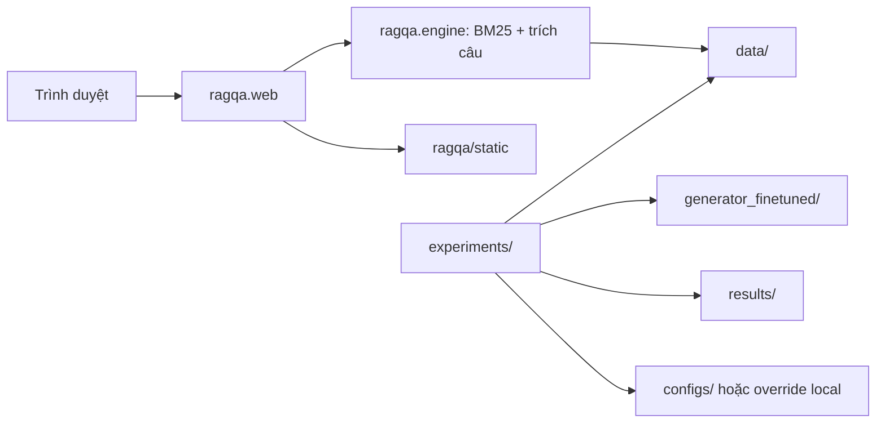

# Cấu trúc và cách chạy project

Project được chia theo trách nhiệm để dễ trình bày đồ án và dễ sửa mã. Web demo BM25 và các thí nghiệm T5/FAISS là hai đường chạy riêng.

## Bản đồ trách nhiệm

| Vị trí | Vai trò | Khi cần sửa |
| --- | --- | --- |
| `ragqa/web.py` | FastAPI, validation và endpoint | Thay API web |
| `ragqa/engine.py` | BM25, chọn câu và telemetry | Thay hành vi retrieval demo |
| `ragqa/static/` | HTML, CSS, JavaScript | Thay UX/UI |
| `ragqa/paths.py` | Các đường dẫn chung | Thay nơi lưu dữ liệu hoặc kết quả |
| `experiments/` | Chuẩn bị dữ liệu, train, RAG, đánh giá | Thay thí nghiệm nghiên cứu |
| `configs/` | Cấu hình baseline được quản lý bằng Git | Thay hyperparameters mặc định |
| `scripts/` | Công cụ upload artifact | Bảo trì công cụ triển khai |
| `deployment/huggingface/` | Gradio app và requirements độc lập | Deploy Hugging Face Space |
| `tests/` | Kiểm thử engine/API và đường dẫn | Kiểm tra hồi quy |
| `requirements/` | Môi trường demo, test, ML, notebook | Cài đúng nhóm phụ thuộc |
| `notebooks/` | Khám phá dữ liệu và preprocessing QA | Phân tích notebook |
| `data/` | Raw documents, QA pairs, chunks, FAISS index | Artifact đầu vào và trung gian |
| `generator_finetuned/` | Trọng số, tokenizer, cấu hình model | Artifact mô hình local |
| `results/` | JSON/CSV kết quả đo đã lưu | Đọc hoặc lưu kết quả thí nghiệm |
| `.pipeline/` | Cấu hình override và trạng thái local | Trạng thái máy hiện tại; không đưa vào Git |



## Lệnh chạy chính

Chạy từ thư mục gốc `RAG`, trừ trường hợp dùng đường dẫn tuyệt đối đến launcher.

```powershell
# Web nhẹ; không cần GPU hoặc tải mô hình
python -m pip install -r requirements/demo.txt
python app.py
# Hoặc: python -m ragqa
# Hoặc: python -m uvicorn ragqa.web:app --host 127.0.0.1 --port 8001

# Kiểm thử
python -m pip install -r requirements/test.txt
python -m unittest discover -s tests -v

# Liệt kê thí nghiệm; không tải thư viện ML hoặc chạy bước nào
python -m experiments --list
```

Web mở tại `http://localhost:8001`. `python app.py`, `uvicorn app:app` và lệnh kiểm thử engine cũ vẫn được giữ. Package `ragqa` không tự nạp model hoặc khởi động server khi chỉ `import ragqa`.

## Các bước thí nghiệm

Các bước dưới đây cần môi trường `requirements/ml.txt`. Chúng có thể tải dữ liệu/mô hình, chạy huấn luyện hoặc ghi đè artifact; không cần chạy lại để mở web khi corpus đã có.

| Bước | Lệnh chính | Lệnh cũ vẫn hỗ trợ |
| --- | --- | --- |
| Tải dữ liệu | `python -m experiments.download_dataset` | `python 00_download_dataset.py` |
| Chia đoạn | `python -m experiments.prepare_chunks` | `python 01_prepare_and_chunk.py` |
| Tách train/test | `python -m experiments.split_train_test` | `python 01b_split_train_test.py` |
| Xây chỉ mục | `python -m experiments.build_index` | `python 02_build_index.py` |
| Fine-tune | `python -m experiments.finetune_generator` | `python 03_finetune_generator.py` |
| RAG T5 + FAISS | `python -m experiments.rag_pipeline` | `python 04_rag_pipeline.py` |
| Đánh giá | `python -m experiments.evaluate --samples 5` | `python 05_evaluate.py --samples 5` |
| Hybrid retrieval | `python -m experiments.hybrid_retrieval` | `python 06_hybrid_retrieval.py` |
| Ablation | `python -m experiments.ablation` | `python 07_ablation_chunk_topk.py` |
| Retrieval baselines | `python -m experiments.baseline_retrieval` | `python 08_baseline_retrieval.py` |
| Upload Hub | `python -m scripts.upload_to_hf` | `python upload_to_hf.py` |

Cũng có thể dùng `python -m experiments evaluate --samples 5`. Các module cụ thể giữ hành vi nhập thư viện ML của bản gốc; `--help` của một số bước vẫn có thể chậm. `python -m experiments --list` và `python -m experiments --help` dùng để xem hướng dẫn nhanh, không nạp các thư viện này.

## Artifact sau khi di chuyển

| Vị trí trước | Vị trí hiện tại |
| --- | --- |
| `raw_documents.json` | `data/raw_documents.json` |
| `baseline_results.json` | `results/baseline_results.json` |
| `ablation_results.csv` | `results/ablation_results.csv` |
| `preprocessing.ipynb` | `notebooks/preprocessing.ipynb` |
| `static/` | `ragqa/static/` |

Dữ liệu raw và hai tệp kết quả được chuyển nguyên nội dung, bao gồm chỉnh sửa local đã có ở baseline. Notebook giữ các cell và kết quả đã lưu, chỉ cập nhật cell đường dẫn để mở từ root hoặc `notebooks/`. Corpus, chỉ mục, train/test và trọng số không được tạo lại.

Mọi đường dẫn artifact trong Python dùng `ragqa.paths`, độc lập thư mục làm việc. Baseline đọc `.pipeline/hyperparams.json` nếu có; nếu không, dùng `configs/baseline_retrieval.json`. Đường dẫn tương đối trong cấu hình được tính từ root repository.

Các tệp `00_*.py` đến `08_*.py`, `pipeline_engine.py`, `test_engine.py`, `upload_to_hf.py` và `app_space.py` ở root là các điểm gọi tương thích. Chỉnh sửa triển khai ở package tương ứng để tránh có hai bản logic khác nhau.

## Triển khai Space

Upload `deployment/huggingface/app.py` thành `app.py` và tệp `requirements.txt` bên cạnh lên một Gradio Space. Cấu hình biến `HF_MODEL_REPO_ID`. Không dùng launcher tương thích `app_space.py` ở root làm tệp độc lập trên Space vì launcher phụ thuộc package trong repository.

## Phạm vi xác nhận

Lần sắp xếp này kiểm tra cấu trúc, import, đường dẫn, engine/API demo và tính toàn vẹn các artifact đã chuyển. Không huấn luyện lại, không upload Hub, không deploy Space và không xác nhận lại chất lượng QA của T5/FAISS. Giới hạn chức năng demo nằm trong [DEMO_READINESS.md](DEMO_READINESS.md).
