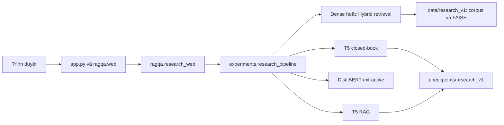

# Bản đồ project và lệnh vận hành

Bản dùng để báo cáo là research_v1. Đọc [hướng dẫn học](HOC_VA_VAN_HANH.md) để hiểu thuật toán; tài liệu này giúp tìm đúng thư mục và lệnh.

## Ba nhóm cần phân biệt

| Nhóm | Thư mục | Mở khi nào? |
| --- | --- | --- |
| Mã và cấu hình | ragqa/, experiments/, scripts/, configs/, requirements/, tests/ | Sửa code, chạy lệnh, kiểm thử |
| Tài liệu và notebook | docs/, notebooks/ | Học đồ án, chuẩn bị báo cáo, chạy Colab |
| Artifact | data/, checkpoints/, results/, outputs/, generator_finetuned/ | Chuẩn bị model/corpus, xem kết quả, bàn giao |

Artifact có nhiều file vì cần lưu predictions, manifests, checksum và provenance. Không di chuyển chúng chỉ để gom thư mục: các đường dẫn đã được khóa hoặc lưu trong hồ sơ thí nghiệm.

## Web và pipeline



| Tệp | Trách nhiệm |
| --- | --- |
| app.py | Điểm mở web; hỗ trợ python app.py và uvicorn app:app |
| ragqa/web.py | FastAPI, static files, route nghiên cứu và demo lịch sử; chỉ mở 127.0.0.1 trừ khi đặt RAG_HOST |
| ragqa/research_web.py | Nạp ba hệ, nhận câu hỏi, gắn reference dev sau inference; reranker và T5 mới là tùy chọn |
| ragqa/static/research.* | Giao diện nghiên cứu |
| experiments/research_data.py | Chọn split, chunking, embedding và index |
| experiments/research_pipeline.py | Template, token budget, retrieval, generation, extraction |
| experiments/research_train.py | Fine-tune hai T5 riêng |
| experiments/research_evaluate.py | Ba hệ, Hybrid, ablation, predictions và metrics |
| experiments/research_ablation.py | Dev: ablation top-k/token budget và cross-encoder reranker |
| experiments/research_train_retrieved.py | Train T5 RAG với context Dense + reranker |
| experiments/metrics.py | Normalization TriviaQA, EM/F1 |
| configs/research_v1.json | Cấu hình chung đã chốt |
| scripts/ | Preflight, báo cáo, đối chiếu replay, so sánh run ablation, công cụ chấm (review_tool.html) và ghép/tổng hợp phiếu chấm, đóng gói |

Các module lịch sử vẫn ở experiments/ và ragqa/ vì còn import hoặc phục vụ /legacy. Xem [bản đồ experiments](../experiments/README.md). Không đổi các đường dẫn phương pháp đã khóa trong lượt sắp xếp này.

## Những lệnh dùng hằng ngày

Từ root RAG, sau khi chuẩn bị đúng artifact và môi trường:

```powershell
python -m pip install -r requirements/demo.txt -r requirements/research.txt
python app.py
python -m unittest discover -s tests -v
python -m experiments --list
```

Mở http://127.0.0.1:8001/research. POST /api/research/load nạp MiniLM, hai T5 và DistilBERT ở nền; GET /api/research/info cho biết ready/loading/error. POST /api/research/execute chạy ba hệ, mỗi tiến trình chỉ xử lý một yêu cầu suy luận tại một thời điểm.

Dựng dữ liệu, train và evaluate theo [hướng dẫn vận hành](HOC_VA_VAN_HANH.md). Không cần chạy lại chúng để mở demo. Các run mới phải có đường dẫn mới; giữ nguyên kết quả đã chốt.

## Tài liệu nằm ở đâu?

- [docs/README.md](README.md): danh mục và thứ tự đọc.
- docs/history/: v2/v3, audit cũ, kế hoạch ban đầu và README dài trước khi thu gọn.
- docs/development/: PRODUCT.md và DESIGN.md cho công việc giao diện.
- [results/README.md](../results/README.md): kết quả hiện tại và bằng chứng lịch sử.

## Lệnh cũ sau sắp xếp

18 launcher/requirements chuyển tiếp ở root đã được đưa ra bản lưu riêng. Logic triển khai vẫn ở package; thay cách gọi như sau:

| Trước đây | Dùng hiện tại |
| --- | --- |
| python 00_download_dataset.py ... và các script 01–08 | python -m experiments.<module> ...; liệt kê bằng python -m experiments --list |
| import pipeline_engine | from ragqa.engine import ... |
| python test_engine.py | python -m unittest discover -s tests -v |
| python upload_to_hf.py | python -m scripts.upload_to_hf |
| requirements_demo/lock/space.txt ở root | requirements/demo.txt, requirements/lock.txt, deployment/huggingface/requirements.txt |
| requirements.txt ở root | requirements/research.txt cho research_v1; requirements/ml.txt cho pipeline lịch sử |
| app_space.py | deployment/huggingface/app.py và requirements.txt cùng thư mục |

Deploy Space là công việc tùy chọn, không phải bằng chứng kết quả research_v1. Lệnh web chính và các lệnh module được giữ nguyên. Bản lưu trước sắp xếp có đường dẫn và SHA trong [biên bản dọn](CLEANUP.md).
