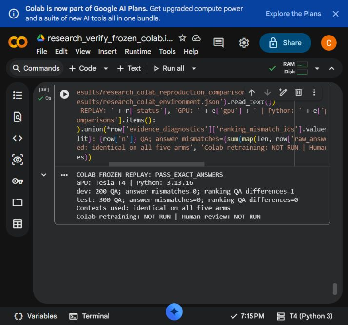

# Kiểm chứng research_v1 trên Google Colab

Lượt chạy hoàn tất ngày **01/11/2026**, hồ sơ cập nhật 02/11/2026. Kết luận: **PASS_EXACT_ANSWERS** cho replay suy luận; một diagnostic thứ hạng dev giữ **REVIEW_REQUIRED**.

## Phạm vi và kết quả

Chạy lại source phương pháp, corpus, index và hai checkpoint đã chốt ở local, đủ **200 dev + 300 test**, năm cấu hình mỗi câu. Cả **2.500 raw answers** khớp local; official/canonical EM/F1 có delta bằng 0 (tolerance cho phép 1e-12). Context thực dùng và các passage đưa vào model cũng khớp. Không fine-tune hay chọn lại tham số. Bộ test đã được đánh giá ở local; lượt này là replay trên môi trường khác.

| Kiểm tra | Kết quả |
| --- | --- |
| Bốn ZIP đầu vào và từng payload | PASS SHA256 |
| Dataset/index, hai checkpoint | PASS preflight, gồm byte hashes và kiểm tra vector |
| Tests core nghiên cứu/metrics trên Colab | PASS 36/36 |
| Tests bộ đối chiếu bổ sung trên Colab | PASS 18/18 |
| Toàn bộ suite local của source bổ sung | PASS 97/97; log outputs/research_colab_validator_local_tests.log |
| Đủ ID duy nhất, schema, manifest, source/data/model identity | PASS |
| Raw answers và QA metrics cả hai split | PASS_EXACT_ANSWERS |
| Context và passage thực dùng | MATCH |
| Thứ hạng retrieval test | MATCH |
| Thứ hạng retrieval dev | REVIEW_REQUIRED ở một câu, xem dưới |
| Import evidence về local | PASS 123 payload hashes; nhập 38 file mới |
| Dựng lại corpus từ nguồn và train lại trên Colab | NOT RUN |
| Faithfulness/citation do người chấm | NOT RUN; phiếu human_author chưa có nhãn |

Môi trường thực: Tesla T4, Python 3.13.16, Torch 2.11.0+cu130; transformers 5.17.0, sentence-transformers 6.1.0, datasets 5.0.1, faiss-cpu 1.15.1, rank-bm25 0.2.2. Suy luận FP32. API BF16 trả true không được dùng để khẳng định T4 hỗ trợ BF16 native hoặc đã tái lập training BF16.

## Khác biệt thứ hạng được giữ nguyên

Câu dev `qb_4397` đổi thứ tự hai chunk Dense ở hạng 23/24; hai chunk này đổi hạng Hybrid 28/29. BM25 không đổi. Toàn bộ thứ tự/thành viên top-1/3/5/10, thành viên top-30, context, đáp án và các retrieval metrics đã báo không đổi. Test không có khác biệt thứ hạng.

Khoảng cách điểm Dense local giữa hai chunk là 2.9802322387695312e-08, phù hợp với giả thuyết nhạy sai số số học; **chưa chứng minh nguyên nhân**. Đối chiếu toàn bộ thứ hạng vẫn REVIEW_REQUIRED, không xóa hoặc chuẩn hóa khác biệt để lấy PASS. Audit chi tiết: [research_colab_ranking_audit.json](../results/research_colab_ranking_audit.json).

## Bằng chứng đã lưu

- [Đối chiếu chạy trên Colab](../results/research_colab_reproduction_comparison.json), [kiểm tra lại tại local](../results/research_colab_local_verification.json), [session](../results/research_colab_session.json), [environment](../results/research_colab_environment.json).
- [Dev replay](../results/research_colab_dev/REPORT.md), [test replay](../results/research_colab_test/REPORT.md): predictions nén, metrics, manifests, source snapshots, score recomputation và các phiếu trống cùng thư mục. Logs từng lệnh: results/research_colab_commands/.
- [Import receipt](../results/research_colab_import_receipt.json): toàn bộ 123 payload được xác minh, chỉ nhập 38 file Colab mới; không ghi đè local source/docs, dữ liệu, model hoặc kết quả gốc.
- ZIP raw evidence tại `outputs/research_colab_evidence.zip`: **45.948.889 bytes**, SHA256 `a6aa21e7d4c56d82053235eccd4efc5e67fa774f19db5e2b3875afa5c5c928ac`. ZIP được chuyển theo các phần có checksum qua giao diện Colab rồi ghép lại với SHA khớp. outputs/ bị Git bỏ qua.
- [Notebook có output đã lưu trên Drive](https://colab.research.google.com/drive/1a935fO3EVh9QnZ-9BU2wT2GHZdI_VZLK) thuộc tài khoản người dùng. **Bản raw executed .ipynb chưa tải được về local**: các cách tải thông thường đều dừng. Giới hạn này không được thay bằng metadata execution tự tạo.
- [Notebook source sạch](../notebooks/research_verify_frozen_colab.ipynb) có schema/AST được kiểm tra; outputs trống, execution_count null. Nó hướng dẫn replay với bốn ZIP gốc và hai file audit, không phải bản sao raw của notebook thực thi. Lượt thực tế dùng staged uploads/prefetch helpers.

Bốn ZIP gốc không được tạo lại sau execution. Checksum nằm trong notebook source và receipt gốc `outputs/bundle_receipts.json`. Gói delivery mới có tên khác, không thay đầu vào frozen.

## Gián đoạn và bộ kiểm tra bổ sung

Phiên lúc 13:58 giờ Việt Nam ngày 01/11 đã hết trước khi tải đủ model; output notebook còn nhưng file runtime mất. Phiên T4 mới bắt đầu lúc 18:32, xác minh lại đầu vào; dev hoàn tất khoảng 18:57, test khoảng 19:05. Không suy ra kết quả model từ phiên gián đoạn.

`scripts/compare_research_replay.py` và tests bổ sung xác minh số dòng/ID duy nhất, schema năm cấu hình, config/model identity theo lock, predictions/source snapshot hashes, raw answers và QA metrics hữu hạn. Hai file được upload riêng và xác minh SHA trước chạy; bốn file phương pháp ML đã khóa không đổi. Source snapshot ZIP có thể khác byte metadata giữa Windows/Linux, nhưng các file phương pháp đã khóa khớp. Log của chính lệnh export trong ZIP được chụp trước khi export xong nên có thể chưa có dòng exit cuối; không dùng riêng log đó làm chứng cứ hoàn tất.

## Phần người dùng cần hoàn tất

Tự chấm [human_review_author.csv](../results/research_v1_test/human_review_author.csv) theo [rubric](REVIEW_RUBRIC.md), điền faithfulness, citation_labels_json và rationale. Có 100 dòng mù cho 50 QA; giữ reviewer_kind là human_author. Chưa có điểm semantic faithfulness/citation từ người chấm và chưa có đánh giá độc lập. Không diễn giải answer match hoặc lexical proxy thành các metric này.
