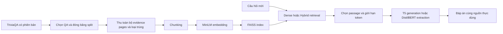

# Học lại đồ án RAG và cách vận hành

Đọc tài liệu này theo thứ tự. Trạng thái chạy thực tế nằm trong [RESEARCH_UPGRADE_STATUS.md](RESEARCH_UPGRADE_STATUS.md); các lệnh train/evaluate cần artifact tương ứng, không có nghĩa chúng đã chạy xong chỉ vì được liệt kê ở đây.

## 1. Đồ án giải quyết việc gì?

Đầu vào là một câu hỏi tiếng Anh. Hệ thống tìm passage trong corpus Wikipedia được cung cấp bởi TriviaQA, rồi dùng passage để sinh hoặc trích câu trả lời. Đáp án chuẩn chỉ phục vụ huấn luyện và chấm điểm; lúc hỏi, hệ thống không tra bảng đáp án để trả lời.

So sánh ba hệ giúp trả lời: truy hồi có giúp mô hình trả lời tốt hơn không, và khi sai thì sai ở bước nào?

| Hệ | Nhìn thấy gì lúc trả lời? | Cách tạo đáp án |
| --- | --- | --- |
| Generator-only / closed-book | Câu hỏi | T5 được train riêng trên question–answer, context rỗng |
| Retrieval-only / extractive | Câu hỏi và passage truy hồi | DistilBERT chọn một span trong passage |
| RAG | Câu hỏi và passage truy hồi | T5 sinh chuỗi đáp án từ ngữ cảnh |

Ngoài ra có ablation dùng checkpoint RAG nhưng bỏ context lúc suy luận. Tên của nó là `rag_checkpoint_no_context`; đừng nhầm với T5 closed-book được train riêng.

## 2. Hai luồng chạy khác nhau



**Chuẩn bị offline:** chọn dữ liệu, chia chunk, xây index, train model. Các bước này có thể mất thời gian nhưng làm trước buổi demo.

**Suy luận online:** nhận câu hỏi, encode query, truy hồi, đưa context vào model, trả lời. Mỗi lần hỏi không tự huấn luyện lại T5.

## 3. Hiểu từng khối

**Chunking:** chia bài Wikipedia dài thành passage. Cấu hình research_v1 là 200 từ/chunk, chồng 40 từ. Overlap giúp hạn chế cắt đứt thông tin ở ranh giới; đổi chunk size phải xây lại index.

**Embedding:** MiniLM biến mỗi passage thành vector 384 chiều. Câu hỏi cũng được encode bằng cùng encoder. Vector không phải đáp án và không phải bảng từ khóa; nó biểu diễn mức tương tự mà encoder đã học.

**FAISS:** lưu vector và tìm vector gần query. IndexFlatIP tính tích vô hướng chính xác; khi vector được chuẩn hóa độ dài 1, tích vô hướng bằng cosine. FAISS là bộ nhớ ngoài, còn trọng số T5 là bộ nhớ parametric.

**BM25:** tìm theo từ xuất hiện trong câu hỏi và passage, có xét độ hiếm/tần suất/độ dài. BM25 thường hữu ích cho tên riêng; điểm BM25 không cùng thang với cosine.

**Hybrid RRF:** kết hợp thứ hạng Dense và BM25 bằng tổng `1 / (60 + rank)`. Nó không cộng trực tiếp điểm cosine với điểm BM25. Có thể tốt hơn hoặc kém hơn Dense; phải đo mới kết luận.

**T5:** mô hình encoder–decoder seq2seq. Input thống nhất là `question: ... context: ...`. Model sinh token tiếp theo cho tới kết thúc/giới hạn độ dài. Passage đúng không bảo đảm model sinh đúng.

**DistilBERT extractive:** chọn vị trí bắt đầu/kết thúc trong token context. Question, special tokens và padding không được xem là span đáp án. Đáp án kiểu `O ' Neill` có thể do tokenizer tách dấu; evaluator phải xử lý đúng.

**Top-k khác số passage thực dùng:** truy hồi 5 passage nhưng cấu hình hiện chỉ đưa tối đa 2 passage vào T5, với tổng input 512 token. Phần text còn lại sau truncation mới là bằng chứng model thật sự thấy.

## 4. Đọc cấu trúc thư mục

| Thư mục/tệp | Vai trò |
| --- | --- |
| `configs/research_v1.json` | Một cấu hình chung cho dữ liệu, retrieval, train và generation |
| `experiments/research_data.py` | Tải nguồn pin revision, chọn split, loại trùng, tìm positive evidence, xây index |
| `experiments/research_pipeline.py` | Template dùng chung, retrieval, sinh và extractive; lưu context thực dùng |
| `experiments/research_train.py` | Train closed-book hoặc RAG, ghi loss/checkpoint/seed |
| `experiments/research_evaluate.py` | Chạy ba hệ, Hybrid và ablation; lưu predictions, metrics, phiếu đánh giá |
| `experiments/metrics.py` | Chuẩn hóa kiểu TriviaQA, EM/F1 và answer policies |
| `experiments/legacy_metrics.py` | Cách chấm cũ để bảo toàn lịch sử; không dùng thay evaluator mới |
| `data/research_v1/` | Corpus/index/split nghiên cứu mới; manifest có checksum |
| `checkpoints/research_v1/closed_book/` | Run train và model closed-book mới |
| `checkpoints/research_v1/rag/` | Run train và model RAG mới |
| `results/research_*` | Kết quả đánh giá, cấu hình và bằng chứng từng câu |
| `ragqa/` | Web FastAPI, giao diện và engine demo |
| `data/demo_v3`, `data/verified_v2`, `generator_finetuned` | Các artifact lịch sử; không trộn với số liệu research_v1 |
| `tests/` | Kiểm thử hợp đồng dữ liệu, cách chấm, API và các lỗi hồi quy |

Các file `00_*.py` tới `08_*.py` ở root giữ lệnh cũ. Với protocol nghiên cứu mới, dùng các module `research_*` để tránh chạy nhầm dữ liệu cũ.

## 5. Dữ liệu train/dev/test dùng như thế nào?

**Train:** cập nhật trọng số. Hai T5 dùng cùng QA IDs được chấp nhận và cùng base model. RAG có positive context; closed-book có context rỗng.

**Dev:** chọn checkpoint/tham số, xem lỗi và thử ablation. RAG validation dùng passage Dense truy hồi, không thay passage đúng bằng gold để làm validation dễ hơn.

**Test:** chốt một lần khi đã khóa phương pháp. Không chọn câu dễ, không sửa retriever sau khi xem điểm rồi tiếp tục gọi bộ đó là holdout chưa dùng.

Research_v1 chọn 2.000 ứng viên train, 200 dev, 300 test. Kiểm tra evidence chấp nhận 1.866 mẫu train trước kiểm tra token budget; số dùng thực tế nằm trong manifest train. 134 mẫu bị từ chối được ghi lý do. Dev/test không bị xóa vì khó hoặc thiếu bằng chứng.

## 6. Các lệnh vận hành

Chạy PowerShell trong thư mục `RAG`. Cần môi trường ML cho các lệnh nghiên cứu.

```powershell
python -m pip install -r requirements/research.txt -r requirements/test.txt
python -m unittest discover -s tests -v
python -m experiments --list
```

Dựng bộ mới trên máy chưa có artifact:

```powershell
python -m experiments.research_data --reference-manifest data/research_v1/manifest.json --output data/research_colab_v1 --build-index
```

Lệnh trên replay vào thư mục mới; dùng `--data-dir data/research_colab_v1` cho các lệnh train/evaluate tiếp theo. Trên máy đang có research_v1 đầy đủ, dùng mặc định research_v1. Lệnh dừng nếu bộ đã có. `--resume` chỉ tiếp tục lần dựng chưa hoàn tất với cùng cấu hình; bộ hoàn chỉnh được giữ nguyên. Không chạy lại chỉ để mở web.

Train hai model (lần lượt để tiết kiệm GPU):

```powershell
python -m experiments.research_train --system closed_book
python -m experiments.research_train --system rag
```

Đọc `manifest.json` để biết complete/failed, QA IDs, precision, loss và checkpoint hash. `checkpoint-*` chứa trạng thái optimizer/RNG để resume; thư mục `model/` là bản để suy luận. `--resume` kiểm tra cấu hình/source/data trước khi phục hồi.

Đánh giá dev trước, chỉ chạy test sau khi khóa phương pháp:

```powershell
python -m experiments.research_evaluate --split dev
python -m experiments.research_evaluate --split test --final
```

Run mới có thư mục riêng; lệnh không ghi đè kết quả cũ. Test không cho dùng giới hạn số mẫu hoặc model pilot. Không gọi `pilot_*` là model cuối.

Web demo:

```powershell
python app.py
```

Mở `http://127.0.0.1:8001/research`, nạp ba hệ rồi chạy. Trang này dùng đúng artifact và lớp inference của research_v1; các mẫu minh họa lấy từ run dev đầy đủ. Trang gốc chọn research khi đủ hai model; `/legacy` dành cho demo v3 lịch sử. Không nạp model demo trong khi đang train hoặc evaluate trên GPU 6GB. Nếu replay corpus ở thư mục khác, đặt `$env:RAG_RESEARCH_DATA_DIR='data/research_colab_v1'` trước khi chạy app; cặp model phải khớp manifest dữ liệu đó.

## 7. Đọc kết quả đúng cách

| Chỉ số | Câu hỏi nó trả lời |
| --- | --- |
| Doc hit rate@k | Có ít nhất một nguồn liên quan trong top-k không? |
| Doc Recall@k | Đã tìm được bao nhiêu nguồn liên quan trong các nguồn được gán? |
| Answer Recall@k | Top-k có chuỗi đáp án được chấp nhận không? Đây là proxy lexical. |
| EM | Đáp án sau chuẩn hóa có khớp hoàn toàn một reference không? |
| F1 | Token dự đoán và reference trùng nhau tới mức nào? Không xét đầy đủ ngữ nghĩa/thứ tự. |
| Faithfulness | Context thực dùng có hỗ trợ đáp án cho đúng câu hỏi không? |
| Citation correctness | Nguồn gắn cùng đáp án có hỗ trợ phát biểu đó không? |

`official` dùng normalized aliases của dataset; `canonical` dùng một đáp án chính. Hai cách chấm có thể khác nhau. Aliases có thể chứa mục không hợp nghĩa, nên cần xem cả đánh giá ngữ nghĩa và audit nhãn.

Ví dụ phân rã lỗi: corpus không có bằng chứng → thiếu coverage; corpus có nhưng top-k không có → retrieval; top-k có nhưng context bị cắt → chọn context/truncation; context đủ nhưng T5 trả sai → generation. Các nhãn tự động dựa vào chuỗi chỉ là proxy; phiếu người chấm kiểm tra lại ý nghĩa.

## 8. Kịch bản báo cáo 10–15 phút

1. **1 phút:** vấn đề và lý do cần nguồn ngoài model.
2. **2 phút:** sơ đồ pipeline và ba hệ; chỉ ra train khác inference.
3. **2 phút:** dữ liệu/version/split, chống trùng câu và quy tắc positive evidence.
4. **3 phút:** bảng kết quả thật, Dense–Hybrid và các chỉ số đã định nghĩa.
5. **3 phút:** một câu đúng và các lỗi retrieval/context/generation; mở nguồn thực dùng.
6. **1–2 phút:** giới hạn, tái lập Colab, việc cần làm tiếp để phát triển bài báo.

Trước khi trình bày, tự trả lời: Vì sao Recall cao mà EM thấp? Tại sao nguồn đúng nhưng đáp án sai? Hybrid có luôn tốt hơn không? Gold answer có đi vào prompt lúc test không? Model đã thấy bao nhiêu passage sau 512 token? Bạn đã chạy Colab thật chưa? Đâu là kết quả người chấm, đâu là proxy tự động?

Với Antigonus ở demo lịch sử: Hybrid lấy đúng trang nhưng T5 trả The Bear. Cách giải thích là đã cải thiện retrieval nhưng generation còn lỗi; không nói toàn bộ hệ thống đã trả lời đúng. Với Fivestones: corpus demo thêm trang Knucklebones và cả Dense/Hybrid trả Jacks; không gán riêng thành công đó cho Hybrid.
