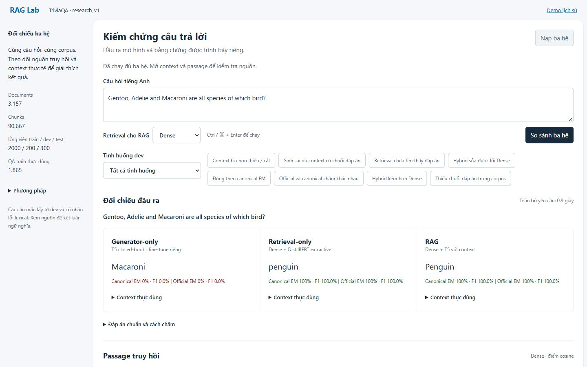
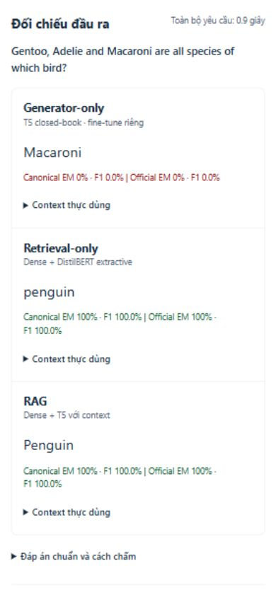

# Xác minh giao diện research_v1

Ngày 01/11/2026, self-verification bằng trình duyệt in-app thật và API local. Dùng đúng artifact research_v1; không thay output bằng nhãn chuẩn. Máy chủ chạy nền ẩn; mở http://127.0.0.1:8001/research. Nếu máy chủ đã dừng, chạy python app.py trong thư mục RAG.

| Kiểm tra | Kết quả | Phạm vi |
| --- | --- | --- |
| Gentoo: ba hệ thực thi | PASS | Closed-book Macaroni; extractive penguin; RAG Penguin |
| Stupa Dense → Hybrid | PASS | RAG Buddhism → Christianity; hai baseline giữ nguyên; cosine/RRF có nhãn riêng |
| Đối chiếu predictions đã lưu | PASS | 4 requests/12 outputs khớp chính xác; results/research_v1_ui_prediction_comparison.json |
| Nhãn cần rà | PASS | Hingis có cờ WTA trước canonical; không thay nhãn hay điểm |
| Filter/stale/loading | PASS | Filter còn một case; đổi query/method báo stale; controls disabled khi chạy; status mới thay lời báo thành công cũ |
| Bàn phím mobile | PASS | Ctrl+Enter chạy; focus đến result-title sau khi hoàn tất |
| Responsive | PASS phạm vi đo | 1440×900 và 390×844 không tràn ngang; ba cột thành ba hàng |
| Chữ hiển thị | PASS phạm vi đo | Min visible text contrast 5,52:1; min visible font 12px ở desktop snapshot |
| Console | PASS phạm vi quan sát | Không ghi error/warn ở các tương tác đã chạy |

Đây không phải audit WCAG đầy đủ hoặc kiểm tra mọi trạng thái trên mọi trình duyệt. Bộ Python có 79 tests; JS syntax và style lint đạt. Kiểm tra giao diện dùng CUA; không coi automated headless inspector là đã chạy.

Các snapshot JSON và ảnh đi kèm trong docs/assets/research_v1. Viewport đã trả về mặc định. Kiểm tra manual Antigonus/Fivestones vẫn trả sai được ghi riêng, không biến thành PASS về chất lượng QA. Tại thời điểm UI audit, phiếu faithfulness/citation người chấm và Colab còn NOT RUN. Kết quả Colab hoàn tất sau đó nằm trong [hồ sơ Colab](COLAB_VERIFICATION_RESEARCH_V1.md); UI audit này không thay thế bằng chứng đó.
