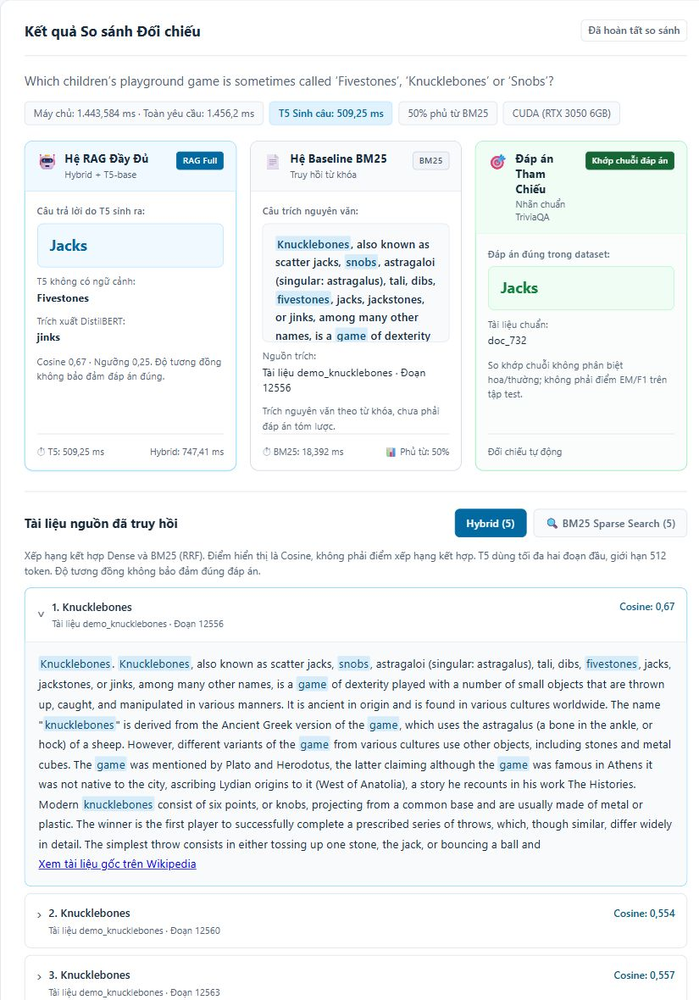

# Xác minh giao diện thực tế — 31/10/2026

Đã kiểm tra trực tiếp tab http://127.0.0.1:8001/ bằng công cụ trình duyệt, đọc DOM và chụp ảnh; không dùng ảnh mô phỏng. Không sửa mã sản phẩm trong lượt xác minh này.

## Kết quả

| Kiểm tra | Kết quả quan sát |
| --- | --- |
| Tải lại trang | Tab cũ hiện 12.556 chunks; sau reload hiện 12.602 và lựa chọn Hybrid/Dense. |
| Bộ lọc mẫu | Chọn “Lần trước thiếu từ khóa” hiển thị đúng Fivestones và Antigonus. |
| Trạng thái xử lý | Nút chạy và các cấu hình bị vô hiệu hóa khi xử lý, dùng lại được khi hoàn tất. |
| Fivestones / Hybrid | T5 trả Jacks, khớp nhãn; mở được passage Knucklebones chứa Fivestones, Snobs và jacks cùng liên kết nguồn. |
| Đổi câu hỏi/cấu hình | Hiển thị “Kết quả của lần tìm trước” và yêu cầu chạy lại. |
| Antigonus / Dense | T5 trả Macbeth, nguồn đầu là William Shakespeare: sai đáp án. |
| Antigonus / Hybrid | Nguồn đầu là The Winter’s Tale, khớp từ hiếm antigonus; T5 trả The Bear: vẫn sai đáp án. |
| Tab nguồn bằng bàn phím | ArrowRight chuyển sang BM25, aria-selected=true; ArrowLeft chuyển về Hybrid. |
| Bố cục | Kiểm tra viewport 1280×900 và 390×844; không phát hiện tràn ngang bằng scrollWidth/clientWidth. Ảnh màn hình hẹp xác nhận biểu mẫu xếp một cột, nhãn và nút đọc được. |
| Console | Không có warning/error trong nhật ký trình duyệt của lượt kiểm tra đã đọc. |

Các tệp mã liên quan khớp SHA256 trong manifest demo_v3_smoke đã chạy trước đó. Kết quả 43/43 unit tests vẫn áp dụng cho mã hiện tại; không chạy lại toàn bộ chỉ vì thêm ảnh và tài liệu. Viewport tạm đã được khôi phục, tab giữ mở cho người dùng.

## Ảnh bằng chứng

[Antigonus với Hybrid — ảnh toàn trang](../assets/ui-verification/antigonus-hybrid.jpg) · [Biểu mẫu ở màn hình hẹp](../assets/ui-verification/mobile-390-direct.jpg)

Xác minh giao diện không có nghĩa mọi câu trả lời đều đúng. Antigonus là lỗi generation còn tồn tại và cần được trình bày trung thực. Các ví dụ được chọn trên corpus demo, không dùng ước lượng độ chính xác toàn tập. Xem [8 trường hợp báo cáo](HUONG_DAN_CASE_DEMO.md) và [phạm vi số liệu khoa học](IMPROVEMENTS_V3.md).
